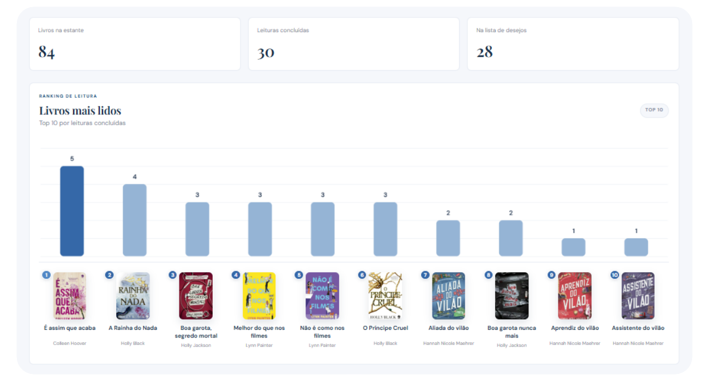

<div align="center">


<h1>Inkora Books</h1>

</div>

**Link:** https://inkorabooks.page.gd/

### Sobre o projeto

O **Inkora Books** é uma aplicação web desenvolvida com o objetivo de criar uma comunidade literária, permitindo que leitores descubram livros, organizem suas leituras e compartilhem suas experiências.

A plataforma oferece um catálogo de livros, estantes pessoais, perfis de leitores e autores, avaliações e interação entre os usuários.

O projeto foi desenvolvido como **trabalho do 4º bimestre do curso técnico de Informática para Internet da ETEC**, colocando em prática os conhecimentos adquiridos durante o curso, especialmente no desenvolvimento web e na integração com banco de dados.

**Tecnologias principais:** PHP, MySQL, HTML, CSS e JavaScript.

---

### Funcionalidades

#### Catálogo de livros
- Visualização do catálogo de livros.
- Pesquisa e consulta de informações literárias.
- Cadastro, edição e exclusão de livros.
- Cadastro de livros por título, autor ou ISBN.
- Integração com a API da Open Library para consulta de informações e capas.

#### Estante pessoal
- Organização de livros em três categorias:
  - Quero ler.
  - Lendo.
  - Lido.
- Acompanhamento das leituras.
- Visualização das atividades de leitura da comunidade.

#### Comunidade
- Cadastro e autenticação de leitores.
- Perfis personalizados.
- Perfis de autores.
- Possibilidade de seguir autores.
- Avaliações de livros com notas de 1 a 5 estrelas e comentários.
- Galeria de imagens nos perfis de autores.

#### Administração
- Painel administrativo.
- Gerenciamento de clientes, autores e livros.
- Cadastro e gerenciamento de usuários da equipe.
- Visualização de informações e atividades da comunidade.
- Controle de permissões de acesso.



#### Personalização
- Alternância entre tema claro e escuro.
- Upload de fotos de perfil e capas de livros.
- Interface adaptável a diferentes dispositivos.
- Carrossel animado de capas de livros.

---

### Banco de dados

O projeto utiliza MySQL para armazenar informações de usuários, clientes, livros, estantes, avaliações e relacionamentos entre leitores e autores.

Principais tabelas:

- `usuario` — usuários da equipe e autores.
- `cliente` — leitores cadastrados.
- `livro` — catálogo de livros.
- `estante` — organização das leituras dos clientes.
- `autor_seguidor` — relacionamento entre leitores e autores.
- `avaliacao_livro` — avaliações e comentários.
- `galeria_autor` — imagens dos perfis de autores.
- `isbn_cache` — armazenamento temporário de consultas à Open Library.

---

### Como rodar o projeto

#### Pré-requisitos

Antes de começar, você precisa ter:

- PHP 8.0 ou superior.
- MySQL ou MariaDB.
- XAMPP ou outro servidor local.
- Navegador atualizado.

#### 1️⃣ Clone o repositório

```bash
git clone https://github.com/MarianSantos14/inkora-books.git
```

#### 2️⃣ Mova o projeto

Coloque a pasta `inkora-books` dentro do diretório:

```text
C:\xampp\htdocs\
```

#### 3️⃣ Configure o ambiente

Crie um arquivo `.env` na raiz do projeto com as configurações do banco de dados:

```env
DB_HOST=localhost
DB_NAME=inkora_books
DB_CHARSET=utf8mb4
DB_USER=root
DB_PASS=
```

Altere os valores conforme a configuração do seu MySQL.

#### 4️⃣ Configure o banco de dados

1. Inicie o Apache e o MySQL pelo XAMPP.
2. Acesse o phpMyAdmin.
3. Importe o arquivo `schema.sql`.
4. Para carregar dados de demonstração, importe `database/demo_data.sql`.

#### 5️⃣ Crie o primeiro administrador

Acesse:

```text
http://localhost/inkora-books/setup.php
```

Preencha o formulário para criar a primeira conta administradora.

#### 6️⃣ Acesse o projeto

```text
http://localhost/inkora-books/
```

---

### Aprendizados

Durante o desenvolvimento do Inkora Books, foram trabalhados conceitos importantes de desenvolvimento web:

- Desenvolvimento backend utilizando PHP.
- Integração com banco de dados MySQL.
- Operações CRUD (Create, Read, Update e Delete).
- Autenticação e gerenciamento de sessões.
- Controle de permissões de usuários.
- Consultas preparadas utilizando PDO.
- Upload e gerenciamento de imagens.
- Consumo de API externa.
- Organização e reutilização de componentes.
- Segurança com validação de dados e proteção CSRF.
- Desenvolvimento de interfaces e interações com JavaScript.

---

Obs: Dados fictícios e demonstração

Para fins de demonstração e desenvolvimento, a plataforma utiliza dados fictícios.

- **Clientes:** todos os perfis de leitores são fictícios. As fotos utilizadas são de atores de séries que gosto, apenas para representar visualmente os usuários da plataforma.
- **Autores:** são escritores reais, porém os perfis, informações complementares e interações apresentados no projeto são fictícios e foram criados para fins demonstrativos.

Os dados não representam contas ou interações reais dessas pessoas.